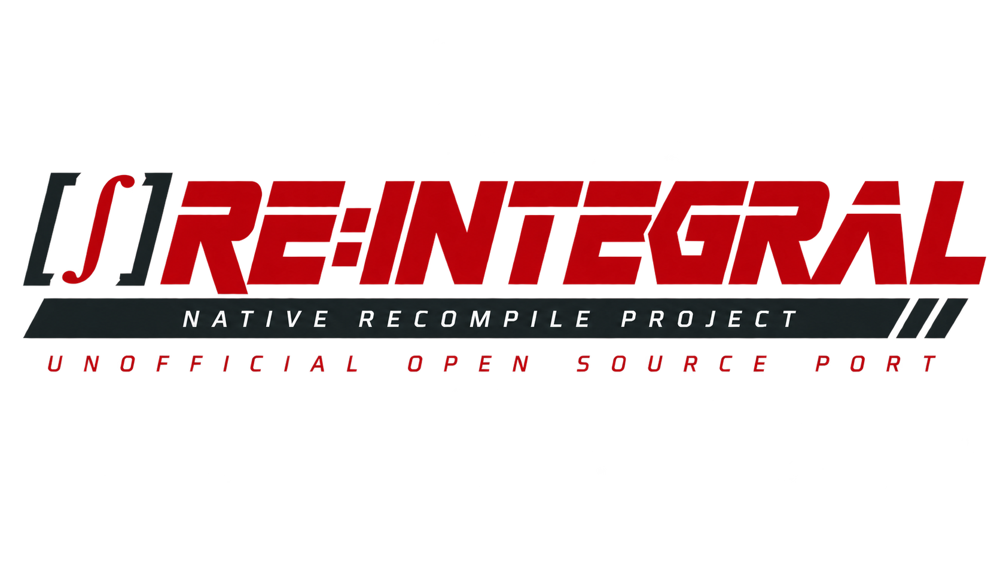

# RE:INTEGRAL



**Metal Gear Solid Re:Integral** is a Windows x86 source port of the original PlayStation *Metal Gear Solid Integral*, built from FoxdieTeam's recovered C and the PsyZ platform library. The immediate goal is a complete native rebuild; a map editor and broader asset tooling come later.

## Play the alpha

Current prerelease: [**0.2.0-alpha.1**](https://github.com/Drommedhar/mgs-reintegral/releases/tag/v0.2.0-alpha.1).

Download the `windows-x86.zip` from [Releases](https://github.com/Drommedhar/mgs-reintegral/releases),
extract it and open **RE-INTEGRAL.exe**. The launcher asks for Integral Disc 1
and Disc 2 CUE files, display settings and optional gameplay/developer options.
It saves settings and memory cards under `%LOCALAPPDATA%\RE-INTEGRAL` so updates
preserve them. No development tools or Python installation is needed to play.
See [alpha requirements, controls and limitations](docs/ALPHA.md).

Alpha 0.2 also supports optional [English and German language packs](docs/LANGUAGES.md)
imported from your own regional discs. Use **Languages → Import from discs…**;
the bundled importer creates packs locally without a Python installation.
Integral remains the gameplay base. Regional coverage is currently partial.

## Roadmap

- **Regional resources:** support text and voice resources from more regions
  and editions, with clear compatibility checks and language selection.
- **Modern rendering:** extend the experimental geometry/depth renderer while
  preserving gameplay behavior and supporting custom graphics and mods.
- **Modding tools:** extend resource overrides to standard image/model/audio
  formats, resized replacements and easier inspection/export workflows.
- **Map and stage editing:** build an editor once resource and renderer
  interfaces support it.
- **Compatibility and coverage:** improve the native release from testing and
  bug reports; expand into VR Missions and future platform support.

These are planned directions. The Godot prototype is paused and is not part of
the native alpha. See the [detailed roadmap](docs/ROADMAP.md).

**Looking for the recreated stage code? Open [STAGE_CODE.md](STAGE_CODE.md).** It
links directly to the recovered C actors, scene logic, controls and source patches.

This is an active development build. On 10 October 2026, the user completed a campaign playthrough through the credits after the fixes recorded in [PROGRESS.md](PROGRESS.md). All 92 main-game stage identities are selected in [config/stages.json](config/stages.json). That completed route does not establish coverage of every branch or optional mode.

Normal startup opens the title sequence with English text selected from Integral's original language resources. The original Options menu can change the language; loading an older save restores its saved settings. `-Stage s00a` remains available for direct development entry. The full stage-recreation goal, concrete evidence and remaining work are tracked in [PROGRESS.md](PROGRESS.md). Upstream's main-executable decompilation milestone does not cover every stage overlay.

## Build

Start in [PowerShell 7](https://learn.microsoft.com/en-us/powershell/scripting/install/installing-powershell-on-windows)
with [Git for Windows](https://git-scm.com/downloads/win) installed, then:

```powershell
git clone https://github.com/Drommedhar/mgs-reintegral.git
cd mgs-reintegral
./tools/setup.ps1
./tools/build.ps1 -Configuration Debug
./build/windows-x86-debug/RE-INTEGRAL.exe
```

If prerequisites are missing, `./tools/setup.ps1 -Install` uses Windows Package
Manager to install Git, Python and Visual Studio Build Tools with C++/Clang
from their official sources. Start with PowerShell 7 installed; open a new
terminal after prerequisite installation, then run setup again. Dependencies
are fetched from upstream and pinned in `sources.lock.json`; this repository
does not mirror tool installers or dependency checkouts.

Use PowerShell 7 on Windows with Git, 64-bit Python 3.11 or newer, and Visual Studio 2022 with C++ x86 tools, a Windows SDK, and the LLVM/Clang component. The scripts locate Visual Studio with `vswhere` and activate its x86 environment. CMake 3.31.8 and Ninja 1.13.1 are downloaded to `.tools` with checksum verification; pinned Python build requirements, including Jinja2 and PyInstaller, are installed into `.venv`. The game remains x86; the bundled language importer uses x64 for its working memory.

```powershell
./tools/bootstrap.ps1
./tools/build.ps1 -Configuration Debug
./tools/build.ps1 -Configuration Debug -Target test
```

The executable is `build/windows-x86-debug/mgs-integral-native.exe`. The Windows x86 target preserves the recovered program's 32-bit pointer and `long` assumptions. An x64 port is deferred; the feasibility audit is retained locally.

An [experimental modern renderer](renderers/modern/README.md) provides optional perspective-correct model textures, subpixel geometry and a floating-point depth buffer. Alpha 0.2 includes it with the enhancements disabled by default. Source builds select it with `-RendererModule renderers/modern`; its launcher exposes the three switches on the **Graphics** tab. A source build without that option retains the original renderer.

The same graphical launcher is built alongside Debug and optimized executables.
Its **Gameplay → Faster map loading (experimental)** option removes presentation
waits during stage reads while preserving loader frames and resource ordering.
It defaults off; `tools/run.ps1 -FastLoading` enables it from PowerShell.
See [loading measurements and validation](docs/PERFORMANCE_DIAGNOSTICS.md#map-loading).

To reproduce an optimized package locally:

```powershell
./tools/build.ps1 -Configuration RelWithDebInfo -RendererModule renderers/modern
./tools/package.ps1 -BuildDirectory build/windows-x86-relwithdebinfo
./.venv/Scripts/python.exe -m tests.test_release build/packages/reintegral-0.2.0-alpha.1-windows-x86.zip --ui
```

GitHub Actions runs only through **Actions → Build alpha release → Run workflow**.
Normal pushes do not trigger builds. One Windows job builds, runs tests, checks
the unpacked player package, and publishes a prerelease after successful
uploads to a draft. Uncheck **publish** for a test build retained for three
days. Published versions need a new alpha number; existing releases and tags
are never overwritten. Hosted CI excludes tests requiring a real GPU; those
are checked locally.

[sources.lock.json](sources.lock.json) pins dependency revisions and the patch order. `bootstrap.ps1 -Check` verifies the existing checkout without applying changes. Bootstrap compares complete cumulative patch states, including patches that edit earlier patches' lines. It preserves the real Git index and refuses conflicting local edits. Keep source changes in `patches/` or first-party files; `vendor/` is downloaded and ignored by Git.

## Import and run

The importer expects the three Japanese Integral BIN/CUE pairs, identified as `SLPM_862.47`, `SLPM_862.48`, and `SLPM_862.49`. Supply your existing disc directory:

```powershell
./.venv/Scripts/python.exe tools/import_content.py --source 'D:/games/Integral-discs' --output .local/content
./tools/run.ps1
```

Import validates executable identities, retains source-image paths and hashes in manifests, and writes extracted resources under `.local/content`. Keep the original BIN/CUE files available: the runtime reads the disc image. Form 2 streams also retain full raw-sector copies. Import refuses an existing output directory, including an incomplete earlier import.

You can supply disc 1 directly with `./tools/run.ps1 -Disc 'D:/games/Integral-disc1.cue' -Stage s00a -Frames 600`. Omit `-Frames` for an unlimited development run. Runtime files, including memory-card directories, go under `.local/runtime`. A clean frame-limit exit establishes that the VSync loop ran; it does not establish successful level loading.

For widescreen at 2560×1440:

```powershell
./tools/run.ps1 -Widescreen -Resolution 2560x1440 -Fullscreen
```

Omit `-Fullscreen` for a window. `-Widescreen` alone selects 1280×720;
`-Resolution` alone retains the original aspect ratio. Widescreen expands the
horizontal scene view, keeps the HUD centred, and presents Codec and movies at
4:3. The renderer draws geometry at a higher internal resolution; retail texture
and movie detail remains unchanged. See [video options and validation status](docs/WIDESCREEN.md)
for rendering limits, fullscreen behaviour and captures. Launching without these
options keeps the existing display settings.

Supply `-DiscTwo 'D:/games/Integral-disc2.cue'` for the original campaign disc-change
screen; imported Disc 2 is selected automatically when its manifest exists.
Press Start when that screen asks. Development entry into a Disc 2 stage can
use its image directly as `-Disc`. The original `change` → Disc 2 → furnace
handoff has passed an automated controller check; see [disc-change evidence](docs/DISC_CHANGE.md).

Direct development entry can also pass the original incoming map: for example,
`-Stage s11a -StageMap 0xa9d5`. This only replaces the initial development load's
map. It does not initialize campaign variables or bypass scenario prerequisites;
later authored transitions retain their own map arguments.

Keyboard controls follow the current backend mapping: arrows for the D-pad, `X` for Cross, `D` for Circle, `Z` for Square, `S` for Triangle, `Q`/`R` for L1/R1, `W`/`E` for L2/R2, Enter for Start, and Backspace for Select. Escape quits; F4 toggles fullscreen; F6 toggles the VRAM view. SDL gamepads are also supported by the backend.

For Psycho Mantis, press **F2** or **click both sticks together (L3 + R3)** to
exchange controller ports. This moves the primary controller and keyboard to
port 2; use the same shortcut to return to port 1 afterward. The prompt is
visible during the fight, including HIDEO, even without `-DebugOverlay`.
Recordings preserve the resulting port packets, analog input and rumble support.

`-MantisMemory random` enables a synthetic memory-card reading drawn from the
original game's recognized titles. Use `-MantisMemory 42` for a repeatable profile
or omit it to read real cards. Record/replay stores the seed automatically.
This changes Mantis's introductory reading only; it does not write save files
or change the run statistics he comments on. A checkpoint after that introduction
does not replay the reading. See [Mantis recovery](docs/MANTIS_RECOVERY.md).

These are physical SDL key positions: the Square binding is labeled `Y` on a
German QWERTZ keyboard. Integral menus use Circle (`D`) to confirm and Cross (`X`)
to cancel. Input uses SDL3 through PsyZ and is independent of Windows; the current
Windows x86 build still has platform-specific scheduler and filesystem adapters.

Xbox controllers use both analog sticks, with A/B/X/Y mapped to Cross/Circle/
Square/Triangle, LB/RB to L1/R1, LT/RT to L2/R2 and View/Menu to Select/Start.
Both controller ports initialize in analog mode. See [native input recording](docs/INPUT_RECORDING.md)
for recording commands, playback status and the complete mapping.

`-BonusItems` adds Stealth Camouflage and Bandana to the original inventory.
Select or remove them normally through the item menu; nothing is forced equipped.
The items persist in ordinary saves. [Bonus-item behavior](docs/BONUS_ITEMS.md).

`-Invulnerable` keeps Snake's health full for testing, including checkpoint
starts. It leaves detection, ammunition and hit reactions active. Recordings
retain the setting and replay restores it automatically. Scripted deaths and
mission-failure conditions still apply. See [recording options](docs/INPUT_RECORDING.md#invulnerability).

`-AutoCard` lets doors use the access card you own while another item remains
equipped. Required card levels still apply; it does not grant cards or automate
the PAL-key puzzle. Recording, replay and resume retain this option.

For an automated input check, use `-Probe new-game -Frames 6000 -Capture build/new-game-probe.bmp`. It starts through the title menu, presses normal skip controls during cinematics and Codec dialogue, and tests movement and collision contact in the dock. `-Probe dock -Frames 3600` tests direct dock entry. These probes use an SDL virtual controller and change input only. Physical-controller drivers are disabled within that test process to keep input deterministic. Automated movement does not establish human playability.

To inspect the complete New Game cinematic, use `-Probe intro -Frames 5000`. This confirms through the title menu and sends no input after leaving it; success requires the original intro to reach the dock Codec. For unattended logos and the submarine opening before the title menu, omit `-Probe`. See [normal startup](docs/NORMAL_STARTUP.md) and [intro timing evidence](docs/INTRO_TIMING.md).

`-Capture` and `-Probe` require a positive `-Frames` limit, except that replay can capture its recorded endpoint without a frame limit. Add `-CaptureEvery 300` alongside `-Capture build/intro.bmp` to save intermediate images as `intro.bmp.000300.bmp`, etc.; the final image keeps the supplied name. Optional `-CadenceLog build/intro.csv` records each VSync, stream/demo progress, camera and rendering timing without changing input or game state. Analyze the closed file with `./.venv/Scripts/python.exe tools/analyze_cadence.py build/intro.csv`. Image readback can add a short stall to its capture frame.

## Resource overrides

The initial mod interface replaces individual resources before the original game loaders process them. Inspect the stage archive first:

```powershell
./.venv/Scripts/python.exe tools/list_assets.py --stage-dir .local/content/disc1/MGS/STAGE.DIR --stage s00a
```

Use an identity marked `Override=True` with `--export <identity> --output <destination>`. Place the exported file at `.local/mods/stages/s00a/<identity>`, edit it in its original binary format while retaining its exact length, and run:

```powershell
./tools/run.ps1 -Stage s00a -ModsRoot .local/mods
```

For example, export a dock texture with `./.venv/Scripts/python.exe tools/list_assets.py --stage-dir .local/content/disc1/MGS/STAGE.DIR --stage s00a --export f072.p --output .local/mods/stages/s00a/f072.p`. Export refuses to overwrite an existing file. The current local validation copy retains the original texture bytes; it proves resource selection, not a visual edit.

Only exact-length resources in their original formats are supported. Compiled stage programs (`.b`) cannot be overridden. Missing override files use the disc resource; malformed or incorrectly sized overrides are errors. Standard image/model importers, resource resizing, a map editor, and validated modded gameplay are future work.

## Validation and provenance

CTest covers content import, asset indexing, stage selection and data lifetime, Japanese literal encoding, disc validation, scheduler fibers, GTE/rotation, resource overrides, controller/SPU adapters, CD transport, audio interrupts and GPU feedback. The Codec regression reproduces the missing frequency with the old renderer and passes with the dependency-order fix. See [current progress](PROGRESS.md) and [validation evidence](docs/VALIDATION.md) for tested configurations and remaining limits.

Scoped aislop checks run as code changes; errors and fixable warnings are blocking. Recovered vendor functions retain nonfixable complexity findings. Some scan engines lack `cppcheck`, `clang-tidy`, or `clang-format`, so these checks do not establish complete static-analysis coverage.

The renderer can be supplied as a separate source module through a CMake target. See [renderer replacement](docs/RENDERER_MODULES.md) for the working build boundary and its current PS1 primitive interface. A modern mesh/material renderer and resized or standard-format asset imports remain further work.

See [architecture](docs/ARCHITECTURE.md), [porting priorities](docs/PORTING_STATUS.md), and [third-party provenance](docs/THIRD_PARTY.md). Retail content is local and ignored by Git.

## Licensing and attribution

Original RE:INTEGRAL software and documentation are available under the
[MIT License](LICENSE), within the scope stated there. Recovered game or SDK
code, game assets or data, third-party material, and patches to upstream code
are outside that grant and retain their applicable terms and notices. The
[source and license inventory](docs/THIRD_PARTY.md) records what we know,
including the missing repository-wide grant in FoxdieTeam's pinned tree and
PsyZ's different license scopes.

If you are an author, contributor, or rights holder and believe our attribution,
licensing information, or use of your work needs correction, please open a
**[Licensing or attribution](https://github.com/Drommedhar/mgs-reintegral/issues/new?template=licensing.md)** issue. We welcome clarification and will review
the information in good faith and make appropriate corrections. The
[issue template](.github/ISSUE_TEMPLATE/licensing.md) helps identify the affected material.

Unofficial project; not affiliated with or endorsed by Konami.
