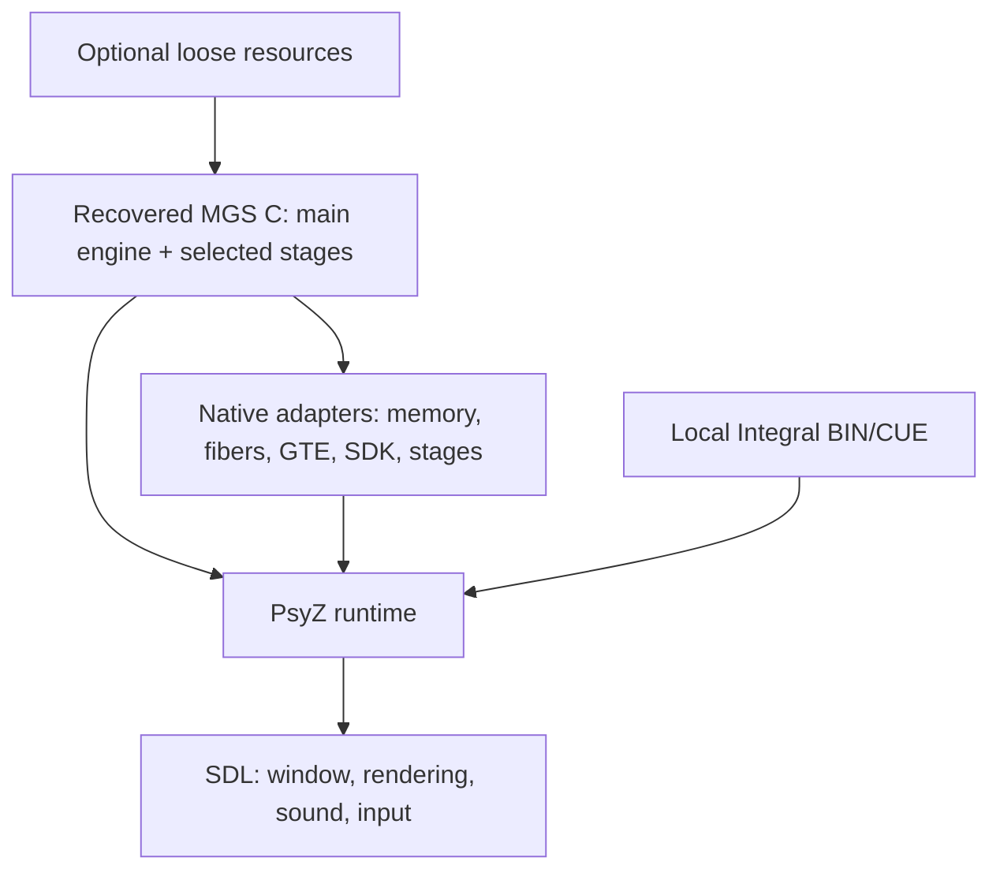

# Native port architecture

The program compiles recovered game C into a Windows executable. PsyZ supplies the PlayStation runtime interfaces and SDL supplies the host platform. The recovered MGS scheduler, resource loaders, actor system, scripts, and rendering submissions remain part of the game code.

## Source and ABI

`tools/generate_sources.py` renders FoxdieTeam's linker template for the stages in `config/stages.json`, deduplicates shared translation units, and gives each stage constructor table a distinct native symbol. It rejects missing sources and unresolved PS1 constructor addresses. The build rejects unimplemented assembly pragmas. Locked patches adapt console assembly, scratchpad accesses, declarations, data layout, scheduler, media/resource paths and initialization-order problems.

The original compiler pipeline converts Japanese literals to EUC-JP. The native build mirrors selected C files and their headers under `build/.../native-source`, using octal escapes for the same literal bytes. `#line` retains original source locations for diagnostics and debugging. The authored vendor files stay readable UTF-8.

The compiler target is `i686-pc-windows-msvc`, using GNU C extensions through Clang and the Microsoft C runtime. Game code uses `-fno-strict-aliasing`, `-fwrapv`, and `-funsigned-char`. Compile-time checks require 32-bit pointers and `long`. Aligned host arrays replace the original fixed RAM and scratchpad regions. Remaining packed fields and address assumptions still require runtime validation.

## Scheduling and callbacks

`src/mgs_threads.c` implements `OpenTh`, `ChangeTh`, `CloseTh`, thread-control-block access, stack diagnostics, and per-fiber critical-section state with Windows fibers. All game tasks share one owner OS thread. The original MTS ready lists, messages, and task priorities decide which fiber runs.

The idle task calls `VSync(0)`. PsyZ polls the platform and delivers pending kernel/VBlank callbacks. An MTS callback marks a deferred scheduling request; it must not switch fibers while PsyZ holds its kernel lock or marks an interrupt active. After VSync returns, idle selects the highest-priority ready task. `PSYZ_POLL_IRQ_ONLY` disables the separate PsyZ IRQ worker for this build. Event masking is restored when moving between fibers, and an attempted switch from an interrupt callback aborts with a diagnostic.

The scheduler test exercises real PsyZ event delivery across two fibers, including critical-state restoration and live stack/TCB data. It does not prove every game timing dependency. CD completion ordering and actor-frame progress remain integration checks.

## Stage loading and content

`src/mgs_stages.c` selects the linked actor table in place of the original overlay tail address. Normal boot opens the title; an explicit development stage redirects the first title request before the original script updates area/history. Unsupported stage identities fail explicitly. Retail stage machine code cannot execute as a Windows overlay.

Generated COFF subsections group each overlay translation unit's writable data and BSS. The host captures initial C data before game initialization. An actual original `.b` overlay load restores the selected units, including shared actors; resident engine state is excluded. A same-area script restart that skips loading retains overlay state. This avoids stale globals on area revisits. Native BSS starts at zero: original retail overlay padding/BSS includes arbitrary bytes, so this is defined native initialization rather than a claim of byte-exact retail uninitialized memory. Tests cover static locals, tentative definitions, pointers, alignment, selected/shared units, and resident-state isolation.

`tools/import_content.py` validates all three Integral discs and writes a manifest with file locations and hashes. Its logical ISO9660 extraction retains raw 2352-byte sector extents for Form 2 stream files. The runtime still uses the original disc image through PsyZ. Importing all three discs does not mean disc switching or VR content runs in this build.

`src/mgs_mods.c` supplies stage/resource overrides after the original resource has been located and before its format loader runs. Names have the form `stages/s00a/abcd.k`, using the archive's identity and extension. Overrides must be regular files of exactly the existing resource size; `.b` stage programs are excluded. This preserves current buffer allocations while providing a small, testable basis for later editing tools.

## Platform SDK behavior

`src/mgs_sdk.c` connects direct pad initialization, communication state, actuator discovery/alignment, and mode selection to PsyZ. An SDL capability query determines whether vibration is available. Each VSync reads the registered mutable actuator buffer and sends low/high motor values through `SDL_RumbleGamepad`; stopping pad communication sends zero vibration and stops subsequent output. MGS initializes both ports in analog mode so connected gamepad sticks are available without an extra mode-selection call. The mode API can still select digital mode. No physical mode-selector button is emulated.

The SDL virtual-controller test verifies actual backend capability discovery and motor output, both ports' four stick axes and packet quantization, keyboard buttons, mode switching, and stopped communication. SDL enumeration recognizes the connected Xbox One Elite 2 Controller; physical gameplay and rumble remain for human verification. `SpuReserveReverbWorkArea` uses PsyZ's SPU allocation records and reservation flag, with tests for both protected memory and allocation conflicts.

The native CD transport delivers completion callbacks through the game thread's VBlank pump at 75 or 150 sectors per second. Its FIFO preserves the requested 2048-, 2328-, or 2340-byte sector view, including split reads. Tests cover modes, callbacks, resets and short reads. Runtime loading uses the original Integral BIN/CUE rather than a synthetic filesystem.

Audio starts an SDL device and uses PsyZ's SPU mixer. DMA completions and SPU RAM interrupt hits queue callbacks for the game thread; the audio thread never switches game fibers. Register and RAM access share the backend's recursive mutex. Tests verify actual RAM transfers, nonzero decoded ADPCM samples, interrupt masking and rearming. End-to-end music, voice synchronization and movies still require gameplay validation. See [backend gaps](BACKEND_GAPS.md).

GTE, rotation, GPU, and memory adapters provide missing host operations while retaining the recovered call sites. PsyZ still contains incomplete SDK functions and compatibility approximations. A successful link is not evidence that all reached functions reproduce console behavior; boot diagnostics and gameplay traces must drive the remaining work.

The GPU backend flushes pending draws when a textured primitive reads a texture page or palette that overlaps the current drawing area. This preserves read-after-write ordering for rendering into textures, including the Codec's frequency display. A pixel-readback regression covers sprites, chained copies, flat/Gouraud textured polygons and palette updates. It fails with the original batching behavior. The corrected Codec capture displays `140.85` and the signal bars.

The optional `--probe dock` attaches an SDL virtual controller, advances the opening Codec through normal input, waits for an unpaused controllable player and a stationary baseline, then attempts directional movement. It succeeds only after observing original game pad input and a changed player position. It changes controller input, never player or script state. `--capture` saves the displayed PSX framebuffer at the requested VSync limit. A probe failure returns a failing exit code even if the frame limit was reached.

One deliberate compatibility adjustment handles the dock script querying a player pose after actor destruction and before recreation. The native port records the previous actor's actual pose and uses it for that query; it reports an error if none exists. The original PS1 code reads low memory through a null pointer in this case. Exact console values remain unverified; see the script trace and behavior difference in [native compatibility decisions](NATIVE_COMPATIBILITY.md).

## Renderer boundary and ongoing work

The [renderer source module contract](RENDERER_MODULES.md) allows replacing the drawing backend without changing actors, game scheduling or audio. The supplied module builds the patched PsyZ GPU implementation through that boundary. It remains a PS1 primitive/VRAM interface; higher-level modern geometry/material rendering will need a separate `libdg` object/mesh interface.

The normal New Game route and the heliport cinematic have automated runtime evidence. Full stage recreation, revisits, boss behavior, saving, disc switching, movies and audio fidelity remain active work. [PROGRESS.md](../PROGRESS.md) records current results. Graphics-format importers and a map editor depend on a stable native engine and explicit resource-format support.
